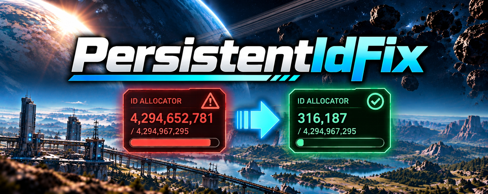
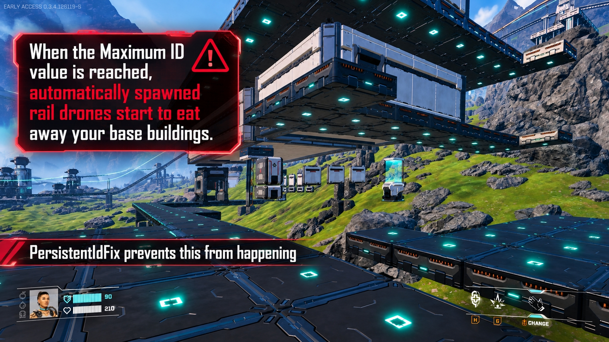
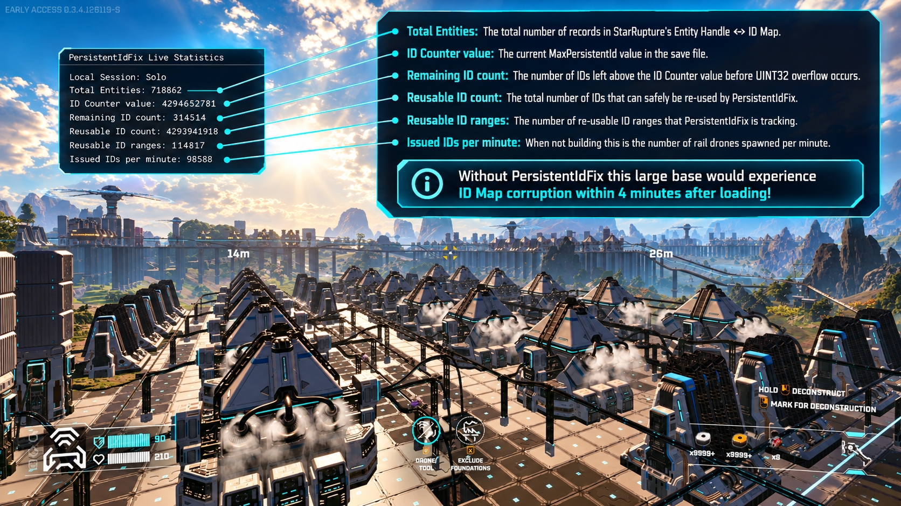

# PersistentIdFix for StarRupture

## Why do I need this?

Have you been playing the same StarRupture world for a very long time and built a huge base, only to start seeing strange things disappear after saving and reloading? One possible cause is persistent ID exhaustion.

StarRupture assigns persistent IDs to entities stored in saves, including buildings, machines, and rail drones. The available ID space is finite. In an old or heavily developed world, the game can eventually approach the maximum value it can store.

Rail drones can consume enormous numbers of IDs over time. A newly spawned rail drone uses an ID, but deleting the drone when it reaches its destination does not necessarily return that ID to the normal allocator. The counter can therefore keep climbing even when the number of entities currently in the world is much smaller.

Exhausting the available IDs can lead to ID rollover, conflicting IDs, and serious save/load problems. In one observed large-save case, parts of a base disappeared after reloading while other entities remained. Persistent ID exhaustion was a possible underlying cause; this does not mean every disappearing building is caused by the same problem.

## How PersistentIdFix helps

PersistentIdFix prevents persistent ID exhaustion by reusing IDs that are absent from the currently loaded save, instead of continually moving the ID counter toward the limit.

- Existing persistent IDs are preserved, not renumbered.
- IDs freed during the current session are not immediately recycled.
- The plugin is preventive, not a save-repair tool.

The banner illustrates ID reuse. PersistentIdFix does not reset or reindex the save's existing IDs or reset its saved ID counter.

## Who is this for?

PersistentIdFix is primarily intended for:

- Long-running StarRupture worlds.
- Large, heavily developed bases.
- Worlds with high rail-drone activity and many entities created over time.
- Saves approaching the persistent ID limit.
- Dedicated servers intended to run a world for a long time.

You do not need to be near the ID limit before installing it. The plugin is designed to prevent the counter from unnecessarily approaching the limit in the first place.

## Tested

Reported testing includes:

- StarRupture client and dedicated server.
- Investigation with WinDbg.
- Small saves and very large saves, including a save with a maximum persistent ID of **4,294,652,781**.
- Saving, reloading, and continued play after ID reuse.
- Dedicated server restart and world reload.
- Continued play on a large save and testing by other players.

No measurable loading-time penalty was observed on the tested large save. This observation is specific to that test, not a guarantee of zero overhead in every world or setup.

## Screenshots

The warning artwork illustrates the observed failure case described above; it is not a diagnosis of every case of missing buildings.

## Requirements

- StarRupture.
- [AlienX Mod Loader](https://www.nexusmods.com/starrupture/mods/89).

PersistentIdFix has separate **Client** and **Dedicated Server** release packages. Download the package for your installation from [GitHub Releases](https://github.com/LetMeInside/StarRupture-Plugin-PersistentIdFix/releases) and use compatible ModLoader and plugin releases.

## Installation

### Client

1. Install AlienX Mod Loader and download the PersistentIdFix Client ZIP.
2. Right-click StarRupture in Steam and select **Manage > Browse local files**.
3. Extract the ZIP into `StarRupture\Binaries\Win64\ModLoader\`.

The archive's `Plugins/` folder places `PersistentIdFix.dll`, `PersistentIdFix.json`, and `PersistentIdFix.pdb` in `StarRupture\Binaries\Win64\ModLoader\Plugins\`.

Alternatively, copy those three files from the archive directly into that `Plugins` directory.

### Dedicated Server

Install the Server package into the dedicated server's own ModLoader installation. Extract the Server ZIP into its `ModLoader` directory so the archive's `Plugins/` folder installs the three files under `ModLoader\Plugins\`. Alternatively, copy the DLL, JSON sidecar, and PDB directly into that installation's `Plugins` directory.

## Usage

PersistentIdFix works automatically; no routine user interaction is required.

On the Client, press **F3** to toggle the **Live Statistics** window. The toggle key is configurable in the plugin's settings. Open ModLoader's **F2** menu to move the widget.

Remote Dedicated Server statistics require matching Client and Server PersistentIdFix versions. The server must have the Server plugin installed; the Client statistics window alone does not protect a remote server's world.

## Live Statistics

The optional window helps you monitor persistent ID usage for the local world or a compatible remote host. It shows:

- Total entities recorded in the game's persistent ID map.
- The current ID counter value.
- Remaining IDs above that counter.
- Reusable ID count and the number of reusable ranges.
- Issued IDs per minute, once a rate is available.

Issued IDs per minute counts newly issued IDs, not only rail drones. The factory overview image illustrates the statistics interface and one large-save example.

## Important

**Back up important saves before installing mods or making changes to an existing world.**

PersistentIdFix is intended to prevent persistent ID exhaustion. It does not repair already corrupted saves, recover missing buildings, or guarantee prevention of unrelated data loss. If ID rollover or conflicting persistent IDs have already occurred, installing the plugin must not be assumed to recover the save or restore lost entities.

**Hot-reload restrictions:** Client hot-reload is supported only from the main menu. Server hot-reload is unsupported; restart the dedicated server when changing the plugin.

## Source Code and License

Source code is available in the [PersistentIdFix GitHub repository](https://github.com/LetMeInside/StarRupture-Plugin-PersistentIdFix).

PersistentIdFix is released under the **MIT License**. See [LICENSE](LICENSE).

## Changelog

See [GitHub Releases](https://github.com/LetMeInside/StarRupture-Plugin-PersistentIdFix/releases) for the current changelog and release downloads. Detailed historical notes remain on Nexus Mods.
